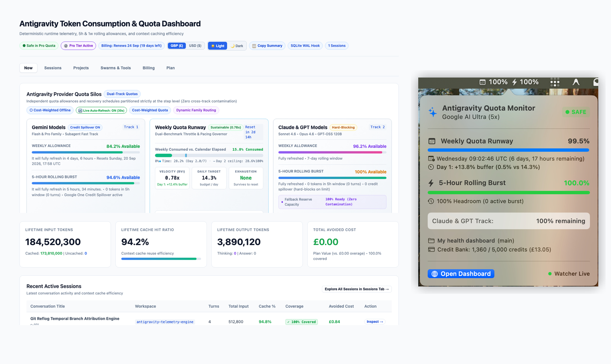
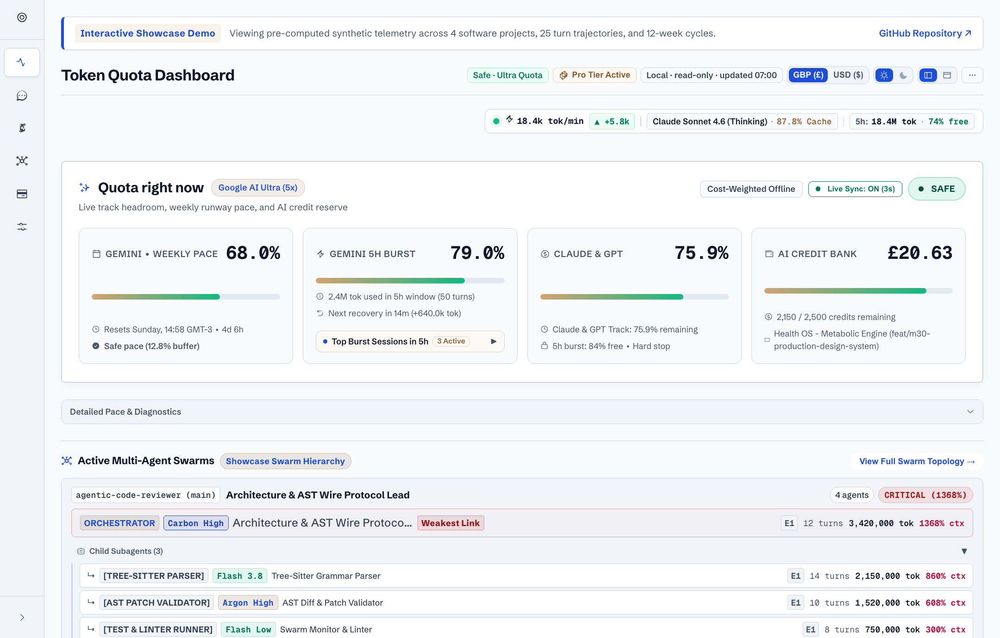
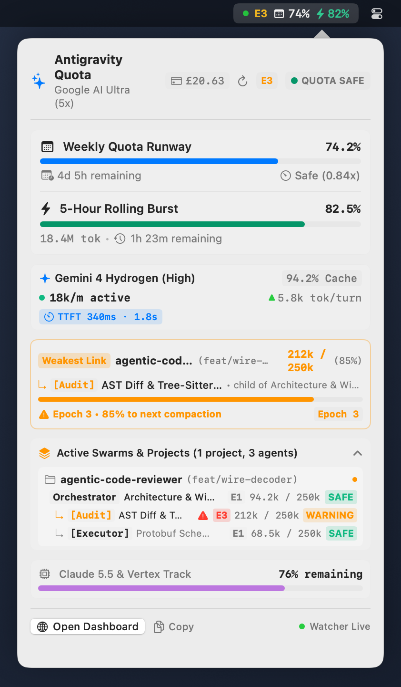
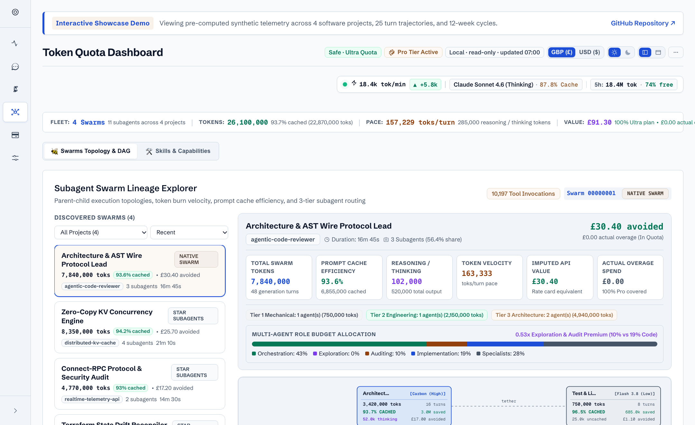
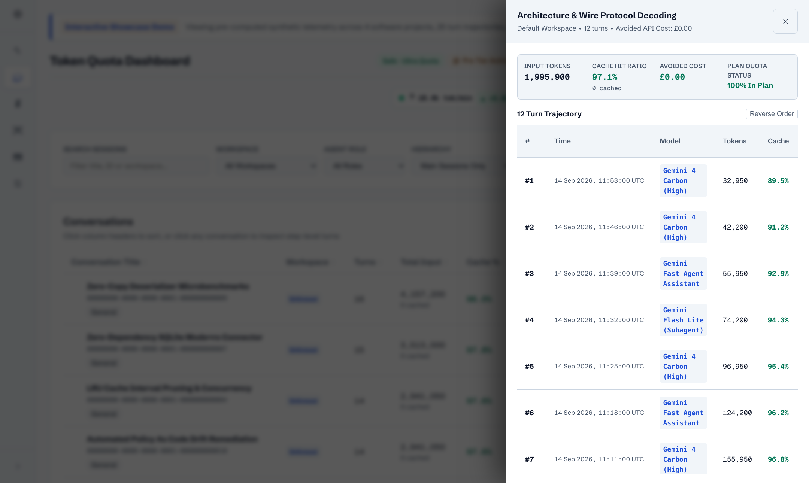
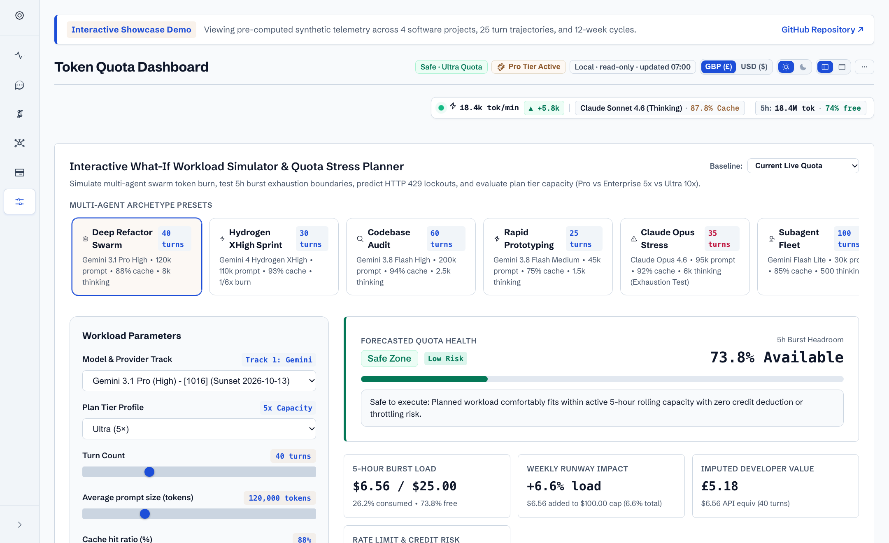
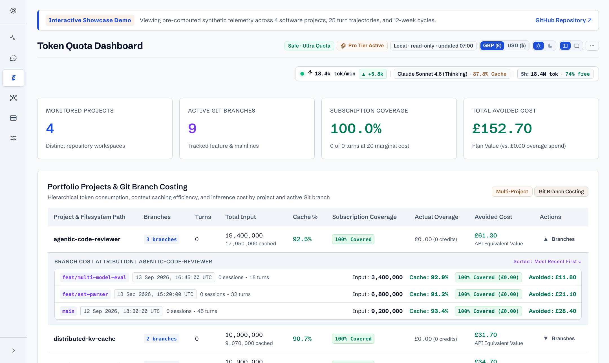

# Antigravity Token Consumption & Quota Dashboard

A deterministic, 100% offline analytics flight deck and ambient macOS menu bar companion for Google Antigravity token consumption, context caching efficiency, and quota velocity.

<p align="center">
  <a href="https://eneasf.github.io/antigravity-token-dashboard/"></a>
  <a href="macos/"></a>
  <a href="https://www.python.org/"></a>
  <a href="docs/TELEMETRY_SPEC.md"></a>
  <a href="LICENSE"></a>
  <a href="docs/SYSTEM_DESIGN.md"></a>
</p>

---

> **Interactive Web Showcase**: [eneasf.github.io/antigravity-token-dashboard](https://eneasf.github.io/antigravity-token-dashboard/)  
> Explore the full interface running in static mode on realistic synthetic telemetry across multi-agent swarms, git branches, and 5-hour burst windows — zero installation required.

---

<p align="center">
  
</p>

---

## Core Tenets & Operating Principles

- **100% Offline & Zero Network Calls**: Reads local SQLite runtime databases and protobuf telemetry (`~/.gemini/antigravity/conversations/*.db`) strictly in URI read-only mode (`?mode=ro`). Prompts, conversation contents, and credentials never leave your machine.
- **Dual-Track Quota Silos**: Independent rolling 5-hour burst and 7-day quota accounting partitioned between Gemini models (Track 1) and Claude & GPT models (Track 2) with Bayesian burn velocity indicators.
- **Subagent Swarms & Deep Reasoning**: Visual DAG hierarchy tracing parent-orchestrator to subagent execution, with dedicated token accounting for thinking and reasoning models.
- **Non-Invasive Architecture**: Never proxies requests, never throttles LLM execution, and never writes to upstream conversation databases.

> **Independent Personal Project & Employer Disclaimer**: This project is a personal, independent work created in personal spare time with no relationship to, connection with, or endorsement from my employer. No employer equipment, internal infrastructure, or confidential data were used.
>
> **Trademark Disclaimer**: Independent community tool not affiliated with or endorsed by Google or Alphabet. Antigravity and Gemini are trademarks of Google LLC.

---

## Visual Feature Tour

The flight deck organizes telemetry across six focused views and a companion native menu bar app:

### 1. Executive Quota Cockpit, Dual-Track Silos & Multi-Horizon Progression
Real-time rolling quota gauges for 5-hour burst windows and 7-day replenishment cycles, partitioned at the step level:
- **Track 1 (Google Gemini Frontier & Flash)**: **Gemini 4 Hydrogen** (`XHigh`–`Low`), **Gemini 4 Carbon**, **Gemini 4 Argon**, **Orchestrator Planners & Executor**, and **Gemini 3.8 Flash** with Google One AI credit spillover monitoring.
- **Track 2 (Anthropic Claude & Vertex Models)**: **Claude Opus 5.5**, **Claude Sonnet 5.5**, and historical models with independent allowances and hard-stop reserve tracking.
- **Executive Hero Bento & Horizon Analytics**: Burn Velocity Index (BVI), active multi-agent swarm strip, multi-horizon progression curves, diurnal latency/TTFT speed profile, and automated quota regime drift / reset-bonus detection.

<p align="center">
  
</p>

---

### 2. Native macOS Menu Bar Companion (`AntigravityBar`)
An ambient status bar monitor authored in native Swift and SwiftUI that stays pinned to your menu bar:
- **Instant Glanceable Headroom**: Color-coded menu bar gauges for 7-day runway, 5-hour burst capacity, and dynamic Compaction Epoch badges (`E1..E5`).
- **Weakest-Link Swarm Popover**: Deduplicated `365px` bento displaying live provider allowances, credit bank balance, weakest-link subagent context risk, and one-click dashboard launch.
- **Two-Tier `<7ms` Fast Ticker**: Sub-millisecond WAL/glog tail watcher updates menu bar status immediately while isolating heavy rollups in background subprocesses.

<p align="center">
  
</p>

---

### 3. Autonomous Subagent Swarm Lineage Explorer
Trace complex multi-agent reasoning hierarchies and autonomous delegator trees:
- **Visual DAG Topology**: Direct parent-to-subagent tree mapping orchestrators to specialized workers.
- **3-Tier Model Routing**: Automated classification across Mechanical Execution, Standard Engineering, and Architecture specialists.
- **Swarm Economics**: Turn counts, prompt cache hit ratios, thinking token velocity, and imputed avoided cost per swarm.

<p align="center">
  
</p>

---

### 4. Turn-by-Turn Telemetry, Wire TTFT & KV-Cache Coaching
Step-by-step turn inspection providing complete visibility into LLM execution:
- **Thinking Token & Wire Latency Decomposition**: Sub-millisecond Time-to-First-Token (`TTFT`) and end-to-end turn latency decoded from raw protobuf wire fields alongside reasoning token accounting for Gemini 4, Gemini 3.8, and Claude 5.5 models.
- **Intra-Family KV-Cache Eviction Coaching**: Uncached vs. cached prompt breakdown with automated detection of mid-session model or effort switches that trigger KV-cache eviction past deep prompt thresholds.
- **Financial Attribution**: Step-level two-era temporal rate valuation and subscription coverage badges.

<p align="center">
  
</p>

---

### 5. Interactive What-If Workload Simulator
Model projected quota impact before launching large agentic jobs:
- **Workload Archetypes**: Quick-load presets for Deep Refactor Swarms, Codebase Audits, Rapid Prototyping, and Claude Opus Stress Tests.
- **Headroom Forecasting**: Interactive sliders for turn count, average prompt length, cache reuse, and thinking effort.
- **Spillover Prevention**: Predicts 5-hour burst saturation and credit bank deductions before execution.

<p align="center">
  
</p>

---

### 6. Workspace Portfolio & Git Branch Attribution
Hierarchical token cost accounting mapped to your local repositories:
- **Project Telemetry**: Tracks token volume, cache reuse, and avoided cost across distinct local codebases.
- **Branch Attribution**: Inspect token expenditure across active feature branches and mainlines with temporal reflog matching.

<p align="center">
  
</p>

---

## Deterministic Data Pipeline Architecture

All metrics derive deterministically from locally stored runtime telemetry:

```
┌────────────────────────────────────────────────────────┐
│  Google Antigravity Runtime (Language Server / IDE)    │
│  ~/.gemini/antigravity/conversations/*.db (WAL mode)   │
└──────────────────────────┬─────────────────────────────┘
                           │ (URI mode=ro, non-blocking)
                           ▼
┌────────────────────────────────────────────────────────┐
│  Antigravity Telemetry Engine & SQLite Vault (Python)  │
│  - Protobuf wire parser, TTFT & turn lifecycle decoder │
│  - Incremental SQLite cache & canonical semantic views │
│  - Calibrated model catalog (schema v2) & temporal pricing│
└──────────┬───────────────────────────────┬─────────────┘
           │                               │
           ▼                               ▼
┌──────────────────────┐        ┌──────────────────────┐
│ dashboard/data.js    │        │ launchd Background   │
│ (Minified & offline) │        │ Daemon & Watcher     │
└──────────┬───────────┘        └──────────┬───────────┘
           │                               │
           ▼                               ▼
┌──────────────────────┐        ┌──────────────────────┐
│ Web Dashboard UI     │        │ AntigravityBar       │
│ (Light / Dark Themes │        │ (Native macOS Menu   │
│  WCAG 2.1 AA)        │        │  Bar App in Swift)   │
└──────────────────────┘        └──────────────────────┘
```

---

## Quickstart

### 1. View the Live Web Demo
Visit [eneasf.github.io/antigravity-token-dashboard](https://eneasf.github.io/antigravity-token-dashboard/) for an instant preview running on static synthetic telemetry.

### 2. Local Telemetry Export
Export your local Antigravity runtime databases to static dashboard data:

```bash
# Export local telemetry
python3 scripts/export_dashboard.py

# Open dashboard in default browser
open dashboard/index.html
```

### 3. Background Live Watcher & Menu Bar Monitor
To keep telemetry refreshed automatically as you code:

```bash
# Register and start the background launchd service
python3 scripts/setup_service.py install

# Inspect daemon health and status
python3 scripts/setup_service.py status
```

For the ambient macOS menu bar companion:
```bash
# Build and install AntigravityBar menu bar app
python3 scripts/build_menubar.py
python3 scripts/setup_menubar.py install
```

### 4. Run Automated Test Suite
Verify local pipeline determinism and schema integrity:

```bash
SKIP_PLAYWRIGHT=1 python3 -m unittest discover -s tests -p 'test_*.py'
```

### 5. Developer & Governance Utilities
Inspect rate card regression math or provision GitHub security guardrails:

```bash
# Verify rate card proportions and mathematical quota convergence
python3 scripts/quota_regression.py --dry-run

# Simulate repository branch protection and CODEOWNERS enforcement
python3 scripts/setup_github_guardrails.py --dry-run
```

---

## Calibration & Configuration

Pricing rates, currency preference, and subscription tier profiles are configurable in `config/pricing.json`:
- **Currency**: Supports GBP (`£`) and USD (`$`) with active exchange rate parity.
- **Model Catalog**: Schema v2 ground-truth model census (`antigravity_telemetry/models.json`) and two-era temporal pricing profiles across active and historical Antigravity models.
- **Plan Tiers**: Calibrated for Google One AI Premium (2TB) and Google AI Ultra (5x Capacity).

---

## Key Documentation

- [Live Interactive Demo](https://eneasf.github.io/antigravity-token-dashboard/) — Web showcase running on static synthetic telemetry.
- [Documentation Hub](docs/README.md) — Map of content across specifications, benchmarks, and reports.
- [Telemetry Findings](docs/FINDINGS.md) — Empirical observations on token usage, KV caching, and quota behavior.
- [Model Benchmarks](docs/MODEL_BENCHMARKS.md) — Reasoning, wire latency, and Connect-RPC quota calibration ledger.
- [Vault Data Dictionary](docs/DATA_DICTIONARY.md) — SQLite vault schema catalog, reference tables, and analytical views.
- [Telemetry Specification](docs/TELEMETRY_SPEC.md) — Protobuf schemas, turn lifecycle events, and data contracts.
- [System Design](docs/SYSTEM_DESIGN.md) — Architecture, offline pipeline, and event sourcing model.
- [Repository Map](docs/REPO_MAP.md) — Directory layout and component catalog.
- [Changelog](CHANGELOG.md) — Chronological release history and capability notes.
- [Architecture Decisions](docs/DECISIONS.md) — Architecture decision records and active governance index.
- [Antigravity Telemetry Package](antigravity_telemetry/README.md) — Standalone Python library documentation.

---

## Contributing

Pull requests and issue reports are welcome. Please ensure all acceptance gates pass cleanly via `python3 -m unittest tests.test_vdone_gates`.

## License

Distributed under the MIT License. See [LICENSE](LICENSE) for details.
