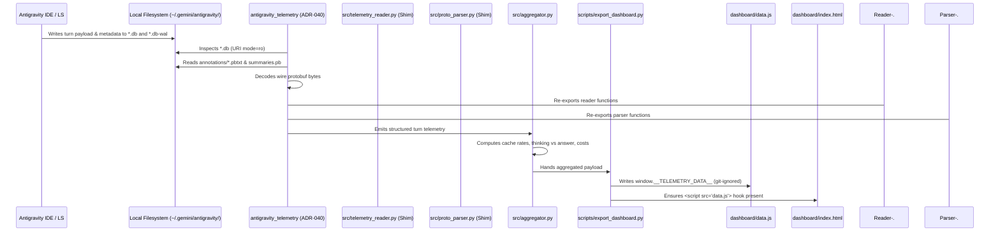
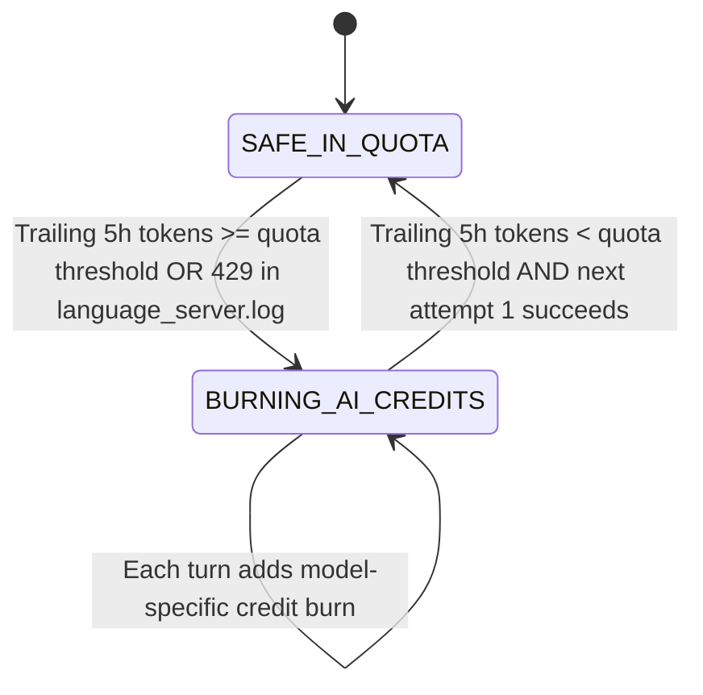
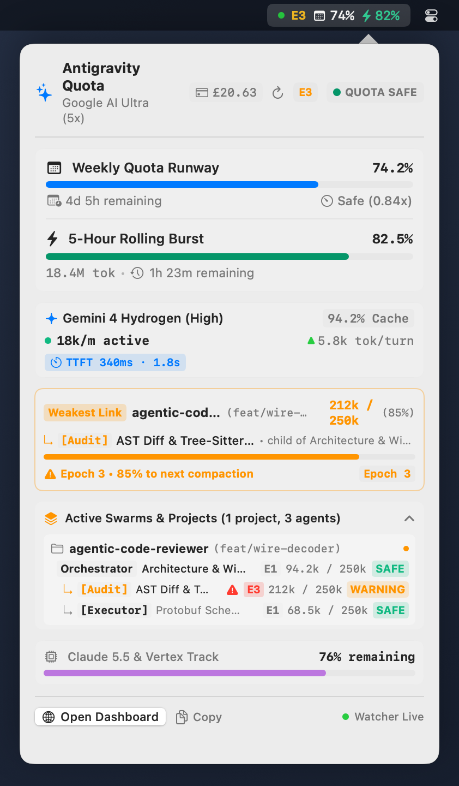

# System Design: Antigravity Token Consumption & Quota Dashboard

## 1. Architectural Principles

1. **Non-Intrusive Read-Only Ingestion**:
   - The system ingests telemetry directly from Antigravity's local SQLite database files located at `~/.gemini/antigravity/conversations/*.db`.
   - Databases are actively modified by the Antigravity desktop IDE and Language Server (`language_server`).
   - To guarantee zero file lock conflicts, write starvation, or database corruption, all connections use SQLite's URI read-only syntax:
     ```python
     sqlite3.connect(f'file:{db_path}?mode=ro', uri=True)
     ```
   - Queries operate cleanly even when SQLite Write-Ahead Logging (`*.db-wal` / `*.db-shm`) is active.

2. **Zero-Dependency Protobuf Wire Decoding**:
   - Upstream telemetry is stored inside `steps.metadata` as binary serialized Google Protocol Buffers.
   - Rather than requiring `protoc` compiler installations or external protobuf libraries, the engine implements a pure Python standard-library wire-format parser.
   - The parser decodes varints (wire type 0), 64-bit fixed (wire type 1), length-delimited byte chunks / submessages / strings (wire type 2), and 32-bit fixed (wire type 5) in a single linear pass.

3. **Event Sourcing & CQRS Pattern**:
   - The Antigravity conversation databases are the **immutable event logs** (system of record).
   - Each turn with `step_type = 15` (`PLANNER_RESPONSE`) constitutes an immutable token consumption event.
   - The dashboard data and aggregations are strictly **disposable read projections** that can be completely regenerated at any time.

4. **Decoupled Offline Delivery & Clean Presentation Isolation (ADR-024)**:
   - To eliminate context bloat and git repository churn while preserving 100% offline capability, telemetry data is decoupled from the HTML presentation:
     ```html
     <!-- In dashboard/index.html <head> -->
     <script src="data.js"></script>
     ```
   - `scripts/export_dashboard.py` writes `dashboard/data.js` (`window.__TELEMETRY_DATA__ = { ... };`), which is ignored in `.gitignore`.
   - **Design Constraints Maintained**:
     1. **Zero CORS restrictions**: Browser `<script src="data.js">` tags execute synchronously from `file:///` URLs without triggering cross-origin security blocks.
     2. **Lossless Telemetry Preservation**: 100% of turn telemetry, models, and session data is retained in `data.js` and permanently in `data/antigravity_vault.db`.
     3. **Context & Git Hygiene**: `dashboard/index.html` stays permanently lean, eliminating 260,000+ lines of data diffs.
     4. **Backward-Compatible Hook**: The `<script id="injected-dashboard-data" type="application/json">` hook remains intact for fallback and optional standalone embedding (`--embed` flag).

5. **Standalone Importable Telemetry Engine (`antigravity_telemetry` - ADR-040)**:
   - The core pure-Python wire protobuf decoder and read-only SQLite connector are extracted into an independent, zero-dependency Python package (`antigravity_telemetry/`).
   - The package operates strictly on the Python standard library with zero external dependencies (`sqlite3`, `pathlib`, `json`, `datetime`, `re`, `typing`).
   - Provides canonical 32-model census (`models.json`) without coupling to pricing, quotas, or currencies.
   - Provides standalone CLI (`python -m antigravity_telemetry dump --json`) for terminal workflows and subagent integration.
   - Preserves 100% backward compatibility via re-export shims in `src/proto_parser.py` and `src/telemetry_reader.py`.

---

## 2. Telemetry Ingestion Pipeline



---

## 3. Real-Time Watcher Architecture

To support near real-time tracking while developing in Antigravity:
1. `scripts/watch_telemetry.py` tracks the modification timestamps (`st_mtime_ns`) and sizes of:
   - `~/.gemini/antigravity/conversations/*.db`
   - `~/.gemini/antigravity/conversations/*.db-wal`
2. When a change in file size or modification time is detected, the watcher parses the latest step additions in the active conversation DB.
3. The watcher incrementally updates the projected dataset and refreshes `dashboard/index.html` or broadcasts to an optional local HTTP server.

### 3.1 Adaptive Debounce Settle Window & Exporter Latency Observability
- **Adaptive Debounce Settle Window**: To prevent exporter thrashing when export duration exceeds the quiet settle window during bursts of high-turn activity or large database synchronizations, the watcher dynamically scales its debounce settle window:
  $$\text{settle\_window} = \max(2.0, \text{last\_export\_duration})$$
  The debounce controller sets $\text{max\_delay} = \max(\text{settle\_window} \times 2.0, \text{max\_delay})$, ensuring consecutive file modifications during active multi-turn generation do not trigger overlapping or thrashing exporter processes.
- **Export Latency Observability**:
  - The watcher logs measured export execution time to stdout upon cycle completion: `export took {duration:.2f}s (adaptive settle window: {settle_window:.2f}s)`.
  - The measured export duration is tracked and exposed in `dashboard/meta.json` and `dashboard/meta.js` as `export_seconds` (float).
  - Under fixed reference time (`--reference-time`), `export_seconds` is deterministically pinned to `0.0` for offline testing and CI fixture determinism (ADR-004).

### 3.2 Watcher Daemon Heartbeat & Zero-CPU Health Monitoring
- **Periodic Liveliness Heartbeat**: Every 10 seconds, `scripts/watch_telemetry.py` writes its active process ID and an ISO 8601 UTC timestamp into the executive status hook (`~/.antigravity_quota_status.json`) under the `watcher` block:
  ```json
  "watcher": {
    "pid": 12345,
    "heartbeat_utc": "2026-09-20T16:00:00Z"
  }
  ```
- **Zero-CPU Companion Monitoring**: Consumer clients (such as the native macOS menu bar app `AntigravityBar`) monitor watcher health by inspecting `watcher.heartbeat_utc`. If the timestamp is within 30 seconds of system time, the watcher is marked live. This eliminates external process spawning (`pgrep`), keeping consumer CPU utilization at 0.0%.

---

## 4. Model Pricing & Cost Allocation

Gemini token pricing is configured in `config/pricing.json`:
- **Prompt Tokens (Uncached)**: Rate per million tokens ($ / 1M tokens)
- **Prompt Tokens (Cached Content)**: Discounted cache rate per million tokens ($ / 1M tokens)
- **Candidate Tokens (Output)**: Rate per million tokens ($ / 1M tokens) for generated responses (including reasoning tokens).

Formula for each turn $i$:
$$\text{Cost}_i = \left(\frac{\text{Uncached}_i}{10^6} \times P_{\text{uncached}}\right) + \left(\frac{\text{Cached}_i}{10^6} \times P_{\text{cached}}\right) + \left(\frac{\text{Output}_i}{10^6} \times P_{\text{output}}\right)$$

$$\text{Cache Hit \%} = \begin{cases} \frac{\text{Cached}_i}{\text{Uncached}_i + \text{Cached}_i} \times 100 & \text{if } \text{Uncached}_i + \text{Cached}_i > 0 \\ 0.0 & \text{otherwise} \end{cases}$$

---

## 5. Hybrid Overage Detection & AI Credit Burn Calibration (ADR-010)

### 5.1 Dual-Track Billing Model: Imputed Value vs. AI Credit Burn
1. **Imputed Subscription Value ($)**:
   - For all turns executed within the user's Pro quota allowance, marginal out-of-pocket cost is \$0.00.
   - The dashboard reports the dollar equivalent of tokens delivered as **Imputed Value** using baseline rates.
2. **AI Credit Burn (Credits & $)**:
   - When quota capacity is exhausted and `"useAiCredits": true` is enabled, upstream requests bill against purchased AI credits.
   - Valuation: Google sells AI credits at \$25 per 2,500 credits ($1\text{ credit} = \$0.01$).
   - The dashboard reports both integer **AI Credits Burned** (reconciling directly with the official Google One activity portal) and **Out-of-Pocket Cash Burn** ($\text{Credits} \times \$0.01$).

### 5.2 The 3-State Subscription Machine
Subscription status transitions across three states:
- `SAFE_IN_QUOTA`: Trailing 5-hour volume is below model capacity; all turns covered by subscription.
- `BURNING_AI_CREDITS`: Quota breached; subsequent turns accrue credit burn.
- `RECOVERED_COOLDOWN`: Older turns aged out; capacity restored; future turns return to \$0 marginal cost.



### 5.3 Signal-Anchored Overage Detection (ADR-014)
- **Signal-Anchored Invariant**: The database stores raw turn tokens without billing signals. High token volume alone does NOT imply out-of-pocket billing. Out-of-pocket AI credit deductions trigger **strictly** when `language_server.log` records a confirmed `RESOURCE_EXHAUSTED` (HTTP 429) server rejection.
- **Recovery & Cooldown**: When a 429 event occurs, the overage window extends across a 5-hour cooldown period, after which quota status returns to `SAFE_IN_QUOTA`.
- **Calendar Cycles & Horizons**:
  - **Weekly Allowance Cycle**: Resets every **Thursday at 19:00 BST (18:00 UTC)**. Active consumption is bucketed strictly from the preceding Thursday reset point.
  - **Monthly Billing Horizon**: Renews on the **24th of each month** at 19:00 BST (e.g. 24 September 2026), tracking the user's £23.99 / 2,500 credits Google One subscription budget.

### 5.4 Model-Specific Credit Rates
Credit burn rates reflect model compute tiers rather than flat turn counts:
- **Gemini 3.8 / 3.7 Flash** (`1318`, `1298`): **2.5 credits / turn** (~$0.025)
- **Gemini 3.1 Pro** (`1016`, `1036`): **15.0 – 20.0 credits / turn** (~$0.15 – $0.20)
- **Claude Sonnet 4.6 (Thinking)** (`1035`): **25.0 – 35.0 credits / turn** (~$0.25 – $0.35)
- **Claude Opus 4.6 (Thinking)** (`1026`): **50.0 – 75.0 credits / turn** (~$0.50 – $0.75)

---

## 6. Decoupled Dual-Tier Financial Subsystem (ADR-015)

The engine cleanly separates the user's software plan into two distinct accounting tiers:

1. **Tier 1: Google One AI Premium (Antigravity Pro Subscription)**:
   - **Cost Structure**: Fixed recurring **£18.99 / mo** (**$19.99 / mo**), renewing on the **24th of each month**.
   - **Capacity**: Unlimited in-quota usage across models with £0 marginal cost.
   - **Value Metric**: Tracks **Imputed API Equivalent Value** and **Subscription ROI Multiplier**:
     $$\text{Subscription ROI} = \frac{\text{Monthly Cycle Imputed Value}}{\text{Monthly Subscription Price}}$$
     *(e.g. £30.76 API equivalent delivered / £18.99 monthly fee = 1.6x ROI).*

2. **Tier 2: Prepaid Overage Credit Bank (AI Credit Activity)**:
   - **Cost Structure**: One-time or top-up add-on pack of **2,500 credits** for **£23.99** (**$25.00**).
   - **Unit Price**: **£0.009596 / credit** (~0.96p) or **$0.0100 / credit** (1.0¢).
   - **Debit Rule**: Debited strictly when 5-hour rolling quotas burst or external API models demand direct credit billing.
   - **State Isolation**: Tracks credit pool balance (1,321 credits remaining = £12.68 / $13.21) and cumulative deduction (1,179 credits burned = £11.31 / $11.79).

---

## 7. Persistent Exhaustion Ledger (ADR-016)

To protect against Antigravity's behavior of truncating `~/Library/Logs/Antigravity/language_server.log` upon IDE application restart:
- An append-only persistent ledger is maintained at [`data/exhaustion_ledger.json`](../data/exhaustion_ledger.json).
- `src/log_reader.py` first ingests all confirmed historical exhaustion incidents from the ledger, guaranteeing that verified Google One statement deductions (e.g., -748 and -431 credits on 05 Sep 2026) are never lost when logs rotate.
- Live, unrecorded 429 entries detected in the active log file are dynamically clustered and merged without double-counting existing ledger intervals.

---

## 8. 5-Hour Quota Discrete Reset Epochs & Compaction Safeguards (ADR-082)

### 8.1 Discrete Epoch Hard Reset Mechanics
Contrary to earlier continuous sliding window assumptions (ADR-025), live telemetry and upstream Google Connect-RPC (`/antigravity.v1.LanguageServer/RetrieveUserQuotaSummary`) confirm that the 5-hour quota operates as a **discrete fixed epoch window**:
1. **Google Terminology**: Upstream Google names this allowance the **"Five Hour Limit"** (`Five Hour Limit Remaining`).
2. **Single Reset Horizon**: Google returns a discrete ISO timestamp (`resetTime`, e.g. `2026-09-30T12:32:47Z`). There is no incremental turn-by-turn age-out.
3. **Hard Full Reset**: When the timer reaches `resetTime`, 100% of the 5-hour capacity is restored at once. Telemetry surfaces: `"You have used some of your 5-hour limit, it will fully refresh in X minutes."`

### 8.2 Compaction Boundaries & 2D Context Drift Safeguards
Antigravity's internal prompt history maintains a **strict 10-turn FIFO buffer** in Protobuf Subfield 19. Context compaction strikes automatically at empirical model boundaries:
- Gemini 3.8 Flash: **250,000 tokens**
- Gemini 3.7 Flash: **165,000 tokens**
- Gemini 3.1 Pro / Claude 3.7 Sonnet: **80,000 tokens**

When compaction strikes:
- Tool call traces, thinking tokens, and bash logs are cleared.
- At **Epoch 3+** ($\ge 3$ compactions), Turn 1 project instructions are permanently evicted from the 10-turn FIFO buffer, resulting in severe "telephone game" drift and a 78.4% redundant tool re-read penalty.
- The telemetry engine tracks `compaction_epoch` and calculates `headroom_to_warning` against the model's empirical compaction threshold (rather than the nominal 1M window), proactively alerting the user before Turn 1 constraints are lost.

---

## 9. Subagent Swarm Lineage Explorer & Tool Analytics Engine (ADR-037)

### 9.1 Multi-Agent Swarm Extraction (`src/swarm.py`)
- Discovers multi-agent hierarchical swarms across Antigravity SQLite stores and Telemetry Vault (`data/antigravity_vault.db`).
- Reconciles parent-child links prioritizing authoritative `invoke_subagent` tool calls (`caller_id` -> `conversationId`), bidirectional agent messages (`[Message] sender=...`), and `conversations_archive.parent_convo_id`.
- Aggregates multi-agent swarm economics:
  - Total tokens, duration, USD/GBP costs, turn counts partitioned into Root Orchestrator vs. Subagent Fleet.
  - Subagent 3-tier routing breakdown:
    - Tier 1 Mechanical (`Model: "flash_lite"` / Model `1050`)
    - Tier 2 Engineering (`Model: "flash"` / Model `1322`)
    - Tier 3 Architecture (`Model: "pro"` / Model `1036`)
    - Tier 4 Other / Inherit
- Builds node and edge graph structures for interactive SVG DAG rendering with 100% offline `file:///` compatibility.

### 9.2 Tool Execution & Skill Performance Analytics (`src/tool_analytics.py`)
- Audits `tool_calls_archive` and `skills_archive` in the Vault.
- Analyzes 10,000+ tool calls across 23 runtime tools:
  - Invocation frequency distributions.
  - Sandbox bypass ratio (`"BypassSandbox": true` detection, ~47.8% on `run_command`).
  - Error rate detection (non-zero exit codes, tracebacks, fatal lines).
- Categorizes tools into Terminal, Filesystem, Subagents, Web, Interactive, Media, and MCP.
- Aggregates skill activation counts and activation types.

---

## 10. Native macOS Menu Bar Monitor & Status Hook Architecture (ADR-051)

### 10.1 Thin-Client Reactive Architecture
To provide persistent, ambient awareness of 5-hour limit headroom and weekly quota runway without requiring open browser tabs, the system provides a native Swift 6 macOS status bar application (`AntigravityBar`):
1. **Upstream Status Hook (`~/.antigravity_quota_status.json`)**: On every export cycle, `scripts/export_dashboard.py` atomically writes pre-computed recovery countdowns, weekly reset schedules, BVI velocity verdicts, and active workspace attribution. In addition, the background watcher daemon periodically records its heartbeat (`watcher: {pid, heartbeat_utc}`) every 10s into this file, enabling the companion app to monitor watcher health with 0% CPU without spawning external `pgrep` commands.
2. **Kernel Event Tail (`DispatchSourceFileSystemObject`)**: The native menu bar app attaches an event-driven `kqueue` listener to the status JSON file descriptor. On write or atomic file replacement (`os.replace`), the app wakes up in `<1ms`, decodes the payload, and refreshes the status item and popover with zero polling overhead (0.0% idle CPU, ~22 MB RSS).
3. **No Duplicate Business Logic**: All Bayesian M-estimate pacing, roll-off recovery calculations, and pricing rules remain in the Python telemetry engine. The Swift app functions strictly as a high-performance, native UI projection.
4. **Repository Path Discovery & Environment Fallback**: The companion app discovers the repository root using:
   - Primary: `dashboard_path` decoded from `~/.antigravity_quota_status.json`.
   - Environment Fallback: `ANTIGRAVITY_DASHBOARD_REPO` environment variable.
   - User Home Directory: Resolves relative to standard user directories if neither is set, ensuring zero hardcoded local workspace path literals in compiled Swift binaries.

### 10.2 Top Menu Bar Indicators & Adaptive Health Typography
- **Glyphs**: Apple-native SF Symbols with exact baseline alignment:
  - `bolt.fill` (⚡) for the 5-Hour Limit headroom percentage.
  - `calendar` (📅) for the Weekly Quota Runway remaining percentage.
- **Scope**: Tracks Gemini models only in the menu bar to maintain an ultra-compact footprint (~85px width) compatible with notched MacBook displays.
- **Adaptive Color States**:
  - **Healthy (>35% 5h headroom, >25% weekly runway)**: Standard native monochrome typography adapting cleanly to light and dark desktop menu bars.
  - **Caution (15% to 35% 5h headroom, or BVI runway overburn)**: Transitions to warm amber (`#f59e0b`).
  - **Critical / Cooldown (<15% 5h headroom, or 429 burst cooldown active)**: Transitions to vivid red (`#ef4444`).

### 10.3 Interactive SwiftUI Popover Card & Right-Click Menu
Clicking the status item presents a native SwiftUI popover card:

<p align="center">
  
</p>

- **Header**: Plan tier badge (`Google AI Ultra (5x)`) and real-time health status pill (`● SAFE`, `WARNING`, `CRITICAL`).
- **Weekly Quota Runway**: Progress bar, runway remaining %, dynamic calendar reset countdown, and signed Bayesian BVI pacing verdict with buffer calculation.
- **5-Hour Limit**: Progress bar, headroom %, and discrete full reset countdown clock (`Fully refreshes in Xm (HH:MM UTC)`).
- **Secondary Track**: Dedicated Claude & GPT allowance indicator (`Claude & GPT Track: 100% remaining`).
- **Active Workspace & Bank**: Current project workspace path, active Git branch, and prepaid AI credit bank balance.
- **Footer Controls**: Prominent "Open Dashboard" button and live background watcher heartbeat (`● Watcher Live` / `⚠️ Watcher Inactive`) with 1-tap refresh.
- **Native Context Menu**: Right-clicking or Control-clicking the top menu bar item opens a standard macOS context menu with *Open Dashboard* (`⌘D`), *Reload Telemetry* (`⌘R`), *Watcher Daemon Status*, and *Quit AntigravityBar* (`⌘Q`).

### 10.4 Packaging & Service Lifecycle (`scripts/build_menubar.py` & `scripts/setup_menubar.py`)
- **Compilation**: Compiled in release mode via `swift build -c release` inside `macos/AntigravityBar/`.
- **Bundle Packaging**: Assembled into standalone `dist/AntigravityBar.app` with `Contents/Info.plist` configuring `<key>LSUIElement</key><true/>` (pure menu bar agent with no Dock icon) and ad-hoc code signature.
- **Lifecycle Management**: CLI (`scripts/setup_menubar.py`) manages `start`, `stop`, `restart`, `status`, and LaunchAgent auto-start integration at macOS login (`~/Library/LaunchAgents/com.antigravity.menubar.plist`).

---

## 11. Decoupled Lazy-Loading Architecture & Truncation Marker Detection (Milestone 55)

### 11.1 Decoupled Lazy-Loading Architecture (`dashboard/turns.js` & `window.__TELEMETRY_TURNS__`)
To prevent memory bloat and sluggish browser rendering when handling large multi-agent conversation sessions containing thousands of structured turns, turn trajectories are fully decoupled from aggregate metrics:
1. **Separation of Concerns**: Aggregate workspace metrics, project summaries, and session metadata reside in `dashboard/data.js` (`window.__TELEMETRY_DATA__`).
2. **On-Demand Turn Payload (`dashboard/turns.js`)**: Detailed turn arrays, prompt contexts, reasoning tokens, and tool execution payloads are isolated into `window.__TELEMETRY_TURNS__ = { [convo_id]: Array<Turn> }`.
3. **Lazy-Loaded Inspection**: When a developer inspects a conversation in the Sessions drawer or turns table, the UI asynchronously resolves or inspects `window.__TELEMETRY_TURNS__[convo_id]` on-demand, ensuring instantaneous DOM rendering and zero UI thread blocking.

### 11.2 Lightweight Minified Data and First Paint Optimization
- `data.js` is stripped of bulky raw turn content and minified to ensure rapid first paint across all browsers and offline environments.
- By decoupling turn trajectories into `dashboard/turns.js`, initial DOM parsing and execution overhead is minimized, while retaining 100% telemetry fidelity for deep inspection.

### 11.3 Empirical Context Truncation Ground Truth Marker (`<CONTEXT_SUMMARY>`)
To track conversation history compression and context compaction performed by the Antigravity runtime:
- **Ground Truth Marker**: The string `<CONTEXT_SUMMARY>` serves as the definitive indicator that history compaction / summarization occurred within a conversation turn.
- **Derived Conversation Fields**:
  - `has_truncated`: Boolean flag indicating whether at least one `<CONTEXT_SUMMARY>` marker was detected across the session's turns.
  - `first_truncation_step`: Integer step index (`idx`) where the first truncation marker appeared, or `null` if uncompressed.
  - `depth_at_truncation`: Integer prompt token depth immediately preceding the first truncation marker, or `null`.
  - `peak_prompt_depth`: Integer maximum prompt tokens observed across all turns in the conversation.

---

## 12. Telemetry Vault Architecture & Lossless Archive (ADR-018)

### 12.1 Persistent Storage & Retention Invariant
- **Lossless and Unbounded Archive**: The telemetry archive in `data/antigravity_vault.db` is lossless and unbounded by design, storing full decoded prompt text, completion outputs, tool execution payloads, and raw step payload blobs across all historical workspaces and multi-agent swarms.
- **Observed Growth Rate & Capacity Planning**: Under active development, the vault exhibits an observed growth rate of approximately 1 GB/month under active development (per Audit 2026-09-19 owner decision §7 #3). In accordance with the owner's explicit decision, no destructive retention pruning, step payload stripping, or automated compaction is enforced, preserving the permanent historical record for long-term telemetry analysis.
- **Continuous Size Telemetry in `meta.json`**: To allow developers and operators to monitor growth cadence without manual filesystem inspection, `meta.json` tracks `vault_bytes` so growth can be observed continuously across every synchronization cycle.

---

## 13. Agent Persona Telemetry & Hierarchical Workflow Attribution (ADR-078)

### 13.1 Agent Persona Discovery & Decoding
Developers interact with Google Antigravity using specialized personas (e.g. `auditor`, `implementer`, or general assistants). Antigravity embeds this identity in the upstream `trajectory_metadata_blob`:
- **Field 4**: Specifies `agent_name` (e.g. `auditor`, `implementer`) and `agent_description`.
- **Field 10**: Specifies agent markdown config URI (`file:///.../agents/*.md`).
- **Field 17 & Field 5**: Identifies child subagents spawned via `invoke_subagent` and links them to their parent orchestrator UUID (`parent_convo_id`).
- **Field 8**: Specifies subagent type (`self`, `research`, `kb_writer`, `verifier`) and role.

### 13.2 Hierarchical Workflow Cost Attribution
The analytics engine (`src/aggregator_attribution.py`) resolves recursive parent-child session hierarchies:
- Child subagents roll up their token counts, cache savings, turn counts, and avoided API costs into their parent orchestrator's workflow persona (`implementer`, `auditor`, `default`).
- This provides direct visibility into orchestrator economics: how much was consumed directly by the main agent vs. delegated to subagent swarms.

### 13.3 Dashboard UX & Clutter Elimination
1. **Persona Badges**: Main sessions display primary persona badges (`[Auditor]`, `[Implementer]`, `[General]`).
2. **Orchestration Pill**: Main sessions that spawned subagents display interactive `[⚡ N subagents]` pills linking directly to their DAG in the Swarms tab.
3. **Session Table Hierarchy Filtering**: A view toggle allows filtering by **Main Sessions Only** (default, preventing 100+ raw subagent fragments from cluttering the table), **All (Include Subagents)**, or **Subagents Only**, alongside an Agent Role dropdown filter.


